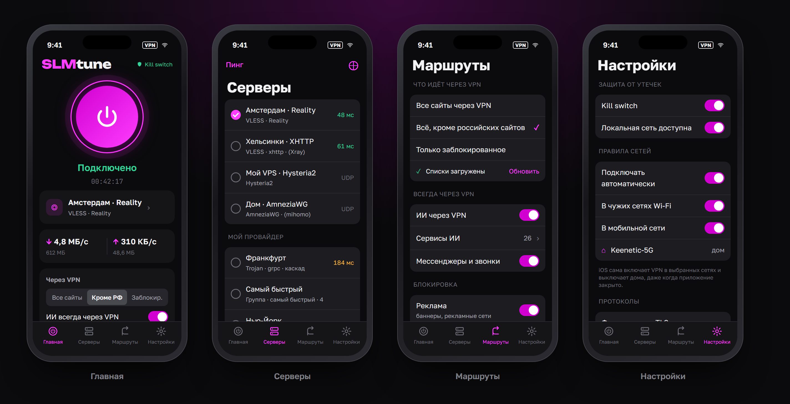
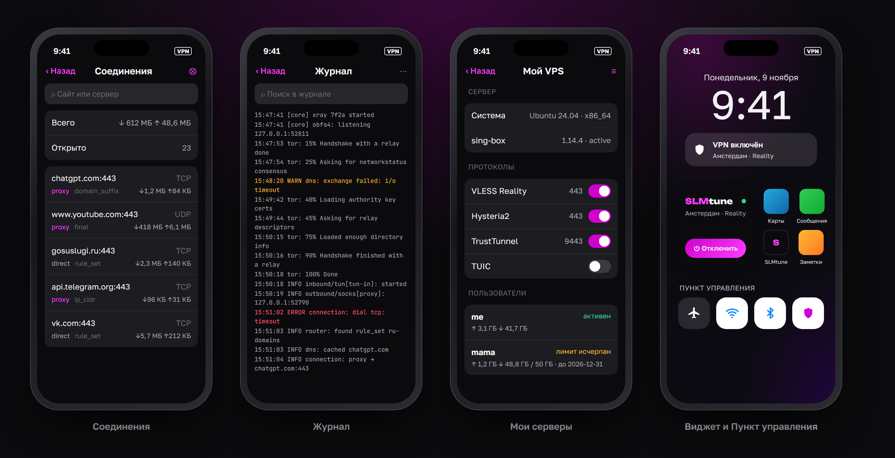

# SLMtune для iOS (4.1 beta)

[](https://github.com/SLM322/slmtune-ios/actions/workflows/ios.yml)


VPN-клиент SLMtune для iPhone и iPad. Те же серверы, ссылки, подписки и правила, что в версиях для Windows и Android.
Пять ядер работают внутри одного VPN-туннеля iOS: **sing-box**, **Xray**, **mihomo**, **TrustTunnel** и **Tor**.

**[Страница со всеми функциями и макетами экранов →](https://slm322.github.io/slmtune-ios/showcase.html)**




<sub>Макеты нарисованы по коду SwiftUI из этого репозитория, это не скриншоты с устройства. Серверы, трафик и записи
журнала на них — примеры.</sub>

## Возможности

- **Протоколы:** VLESS (Reality, Vision, WS, gRPC, HTTPUpgrade, XHTTP, Encryption), VMess, Trojan, Shadowsocks 2022,
  ShadowTLS, Hysteria2 с port hopping, Hysteria, TUIC, AnyTLS, NaiveProxy, WireGuard, AmneziaWG, mieru,
  ShadowsocksR, SOCKS5, TrustTunnel, Tor с мостами obfs4 / snowflake / webtunnel / meek.
- **Импорт:** из буфера, QR-кодом с камеры или из фото, ссылками `slmtune://`, конфигами WireGuard и Amnezia `vpn://`.
  Подписки Marzban, 3x-ui, Remnawave с остатком трафика и сроком.
- **Маршруты:** все сайты / всё кроме РФ / только заблокированное; ИИ-сервисы и мессенджеры всегда через VPN;
  блокировка рекламы, трекеров и 18+; свои правила по сайтам и IP; DNS через DoH, DoT, DoQ.
- **Серверы:** пинг, группы (самый быстрый или резерв), каскад до 4 серверов, «Поделиться» ссылкой и QR-кодом.
- **Защита:** kill switch (трафик не выходит мимо VPN), автоподключение в чужих Wi-Fi и мобильной сети, дома — без VPN;
  фрагментация TLS и отпечаток uTLS против DPI.
- **Диагностика:** журнал всех ядер, живой список соединений, скорость и трафик.
- **Мои серверы:** свой VPS по SSH с телефона — 12 протоколов, пользователи с лимитами и сроками, ссылки и QR-коды.
- **Виджет** на экране «Домой» и блокировки, **кнопка в Пункте управления** (iOS 18).
- Тёмная тема в цветах SLMtune, русский и английский язык.

## Как поставить

Неподписанные IPA собираются после каждого коммита. Их нужно подписать своим сертификатом (ESign, Feather, Scarlet,
zsign или сервис подписи):

| Сборка | Что внутри | Когда брать |
|---|---|---|
| [**lite**](https://github.com/SLM322/slmtune-ios/releases/tag/unsigned-lite) — `SLMtune-lite-unsigned.ipa`, ~25 МБ | только sing-box | **по умолчанию.** Хватает для VLESS, VMess, Trojan, Shadowsocks, ShadowTLS, Hysteria2, TUIC, AnyTLS, NaiveProxy, WireGuard, SOCKS5. Проверена на iPhone |
| [**полная**](https://github.com/SLM322/slmtune-ios/releases/tag/unsigned) — `SLMtune-unsigned.ipa`, ~46 МБ | sing-box + Xray + mihomo | нужны XHTTP, AmneziaWG, mieru, ShadowsocksR. На iPhone пока не проверена |

- VPN заработает, только если в профиле подписи есть разрешение Network Extension (`packet-tunnel-provider`) —
  подробности в [docs/GITHUB.md](docs/GITHUB.md#4-подпись-купленным-сертификатом-lazyshop-и-подобные).
- App Group приложение берёт из профиля подписи само, переименовывать ничего не нужно.
- В Настройках → «О приложении» видна версия со сборкой, например `4.1 (26) lite`: сверяйте её после установки —
  сервисы подписи иногда подсовывают ранее загруженный файл.
- **С платным Apple Developer** — подписанный IPA или TestFlight одной кнопкой в GitHub Actions: [docs/GITHUB.md](docs/GITHUB.md).

### Если VPN не подключается

Настройки → «О приложении» → **Диагностика** → «Собрать отчёт» → «Поделиться отчётом». В отчёте: сборка, что разрешает
подпись (Network Extension, App Groups), состояние профиля VPN, счётчик байт туннеля, этапы запуска расширения с
остатком памяти и журнал ядра. Паролей и ключей в нём нет. Если запуск оборвался, причина показывается и прямо на
главном экране — текстом, а не кодом `NEAgentErrorDomain`.

## Устройство

SwiftUI-приложение, расширение **Packet Tunnel** (NetworkExtension) и виджет. В расширении работает sing-box (libbox),
а рядом с ним, в том же процессе, — Xray, mihomo, TrustTunnel и Tor для протоколов, которых нет в sing-box.
Логика ссылок, протоколов и маршрутизации перенесена из Windows-версии (`Protocols.cs`, `SingBoxConfig.cs`,
`MoreProtocols.cs`, `ServiceCatalog.cs`, `ServerSetup.cs`) и Android-версии (`ShareLinks.kt`, `Outbounds.kt`,
`ConfigBuilder.kt`, `ExtraCores.kt`, `MyServers.kt`).

## Что проверено, а что нет

Проект написан на Windows, где нет Xcode и Swift.

**Проверено здесь, на Windows:**
- Go-часть (`core/`): sing-box 1.14.4 (libbox) + Xray 26.3.27 + mihomo 1.19.33 + lyrebird (мосты Tor) **компилируются
  для `ios/arm64` и линкуются в один бинарник** (darwin/arm64, windows/amd64) — конфликтов зависимостей нет.
- Тот же код на Windows: Xray и mihomo через функции `slmcore` поднимают SOCKS и проводят настоящий HTTPS-запрос;
  все четыре моста (obfs4, snowflake, webtunnel, meek_lite) запускаются; **tor.exe через встроенный snowflake
  подключился к сети Tor на 100 %**.
- Конфиг mihomo того вида, что строит `Engines.mihomoConfig` (AmneziaWG + mieru + SSR), принимается ядром.
- Конфиг sing-box той формы, что строит `ConfigBuilder.swift` (каскад, группа urltest, WireGuard endpoint, ShadowTLS,
  Hysteria2 с port hopping, TUIC, AnyTLS, Naive, VMess+WS, rule-set, DNS), проходит `sing-box check` 1.14.2.

**Проверено в WSL (Ubuntu 24.04, Swift 6.4.2)** — `scripts/linux-check.sh`:
- общий код `Shared/` (ссылки, outbounds, конфиги sing-box и ядер) компилируется без предупреждений, 19 тестов проходят;
- `tools/ConfigDump` генерирует конфиги для всех 16 видов серверов, каскада через Xray и группы — **все 18 проходят
  `sing-box check` 1.14.4**; сгенерированные конфиги Xray и mihomo принимаются ядрами из `core/`;
- сгенерированный TOML TrustTunnel принят настоящим `trusttunnel_client` (Windows-сборка): он поднял SOCKS на
  127.0.0.1 — тот же режим, что использует iOS-мост.
- Нашёлся и исправлен баг: параметр AmneziaWG `jc` уходил в mihomo строкой. Такое же условие есть в Windows-версии
  (`MoreProtocols.ToMihomoConfig`: `key.StartsWith("j") && key.Length == 2` захватывает и `jc`).

**Проверено на GitHub Actions (macOS 26, Xcode 26.6)** — [SLM322/slmtune-ios](https://github.com/SLM322/slmtune-ios/actions):
`gomobile bind` собирает `Libbox.xcframework` (sing-box + Xray + mihomo + мосты Tor), **все цели — приложение,
VPN-расширение (вместе с Tor.framework), виджет — компилируются и линкуются**, 19 тестов проходят на симуляторе iPhone.

В CI также есть проверка «Go cores start as an iOS binary»: Go-часть обеих сборок собирается как программа для
симулятора iOS и запускается — инициализация всех пакетов и `libbox.Setup`. Она ловит то, что не видно при компиляции
(см. первый пункт ниже).

**Проверено на iPhone** (iPhone 14 Pro Max, iOS 27.2, сборка 26 lite, переподписана купленным сертификатом):
VPN-расширение запускается, туннель поднимается за секунды, трафик идёт. Проверял владелец на своих серверах;
по отдельности каждый протокол не прогонялся.

По дороге к этому на устройстве нашлись и исправлены четыре ошибки, которых не показывали ни компиляция, ни тесты:

1. **Падение расширения при загрузке.** mihomo и sing-box оба несут свой форк Tailscale, и оба регистрируют одни и те
   же переменные `expvar` — паника Go ещё до `startTunnel`. Сборка идёт с тегом `no_tailscale`.
2. **Слишком длинный путь сокета.** libbox открывает `<папка>/command.sock`, а путь Unix-сокета ограничен 103 байтами.
   Без общего App Group папка — личный контейнер расширения, и путь не помещается. В таком случае используется
   локальный TCP-порт с секретом.
3. **Чужие App Group.** Профиль переподписи приносит свои группы (`group.<что-то>.1` …), а не `group.com.slmtune.ios`.
   Приложение и расширение читают список групп из `embedded.mobileprovision` и берут первую доступную.
4. **Зависание запуска на минуту.** `openTun` ждёт завершения `setTunnelNetworkSettings`, а оно приходит в очередь,
   на которой iOS вызвала `startTunnel`. Запуск, остановка и перезагрузка перенесены в собственную очередь.

**Не проверено на устройстве:** полная сборка (Xray, mihomo) и её расход памяти; Tor и TrustTunnel; kill switch,
автоподключение по Wi-Fi, виджет и кнопка Пункта управления; «Мои серверы»; смена настроек при включённом VPN
(на купленной подписи сообщения от приложения к расширению не доходили — после изменений переподключайтесь).
Мост TrustTunnel (C++) в CI не собирался, подпись и загрузка в TestFlight не проверялись.

**Tor в неподписанных сборках сейчас отсутствует:** пакет Tor.framework требует Swift 6.3, а IPA собираются на
Intel-машинах GitHub с Xcode 26.3 (на arm64-машинах были перебои). Серверы типа Tor в такой сборке сообщат, что ядра нет.

## Что из Windows-версии есть на iOS

| Функция Windows-версии | iOS | Как сделано / почему нет |
|---|---|---|
| Ядро sing-box (TUN, правила, DNS) | ✅ | libbox в Packet Tunnel Provider, конфиг строится в расширении из настроек App Group |
| VLESS (TCP/WS/gRPC/HTTP/HTTPUpgrade), Reality, Vision | ✅ | sing-box |
| VMess, Trojan, Shadowsocks (вкл. SS2022), ShadowTLS v3 | ✅ | sing-box |
| Hysteria2 (obfs, port hopping), Hysteria v1, TUIC v5, AnyTLS, NaiveProxy | ✅ | sing-box (`with_naive_outbound`) |
| WireGuard / WARP | ✅ | sing-box endpoint; `wireguard://`, `.conf` |
| **VLESS XHTTP / VLESS Encryption** | ✅ | **Xray** в том же Go-фреймворке, SOCKS на 127.0.0.1 |
| **AmneziaWG, mieru, ShadowsocksR** | ✅ | **mihomo** в том же Go-фреймворке; `wireguard://` с ключами AWG, `.conf`, Amnezia `vpn://`, `mierus://`, `ssr://` |
| **TrustTunnel** | ✅ | клиент AdGuard (C++), фреймворк из их репозитория + наш мост `TTSocksClient` (режим SOCKS, как `[listener.socks]` в CLI); `tt://` |
| **Tor** с мостами | ✅ | Tor.framework (iCepa, C tor) в расширении; obfs4 / snowflake / webtunnel / meek — lyrebird в Go-фреймворке; встроенные мосты из Tor Browser |
| Официальные клиенты Hysteria2 / Naive | ❌ | не нужны: sing-box сам говорит на этих протоколах |
| Импорт: буфер, вставка, QR (камера и фото), `slmtune://`, подписки | ✅ | subscription-userinfo (трафик и срок), profile-title, base64-тела |
| Пресеты: все сайты / всё кроме РФ / только заблокированное | ✅ | те же списки (itdoginfo, v2fly category-ru, ipverse) |
| «ИИ через VPN» с переключателями сервисов | ✅ | каталог из ServiceCatalog (домены; DNS ИИ — через VPN) |
| Мессенджеры/звонки через VPN | ✅ частично | домены + IP-сети Telegram; правила «по приложению» невозможны |
| Игры через VPN/напрямую | ❌ | на Windows это правила по процессам; iOS не сообщает, какому приложению принадлежит соединение |
| Блокировка рекламы, трекеров, 18+ | ✅ | rule-set MetaCubeX (`.srs`), блок и в DNS |
| Свои правила, группы (urltest), каскад | ✅ | ядро из Xray/mihomo/TT/Tor может быть только первым звеном каскада (как в Android) |
| Kill switch | ✅ аналог | `includeAllNetworks` (+ `excludeLocalNetworks`, `excludeAPNs`, `excludeCellularServices`) |
| Правила сетей Wi-Fi («дома без VPN») | ✅ аналог | Connect On Demand по SSID — работает без приложения |
| Пинг, скорость, трафик | ✅ | TCP-рукопожатие; счётчики utun |
| **Журнал** | ✅ | файлы в App Group: sing-box (`log.output`), ядра, Tor; поиск, фильтр ошибок, «поделиться» |
| **Панель соединений** | ✅ | Clash API sing-box на 127.0.0.1 с секретом; список, трафик, закрыть одно/все |
| **«Мои серверы» (VPS по SSH)** | ✅ | Citadel (SSH), те же bash-скрипты, что в Windows/Android; 12 протоколов, пользователи с лимитами и сроками, ссылки, инструменты |
| **Виджет и кнопка в Пункте управления** | ✅ | WidgetKit: малый виджет и виджеты экрана блокировки; на iOS 17+ кнопка прямо в виджете, на iOS 18 — Control Center |
| Zapret / WinDivert / GoodbyeDPI | ❌ | драйверы перехвата пакетов — только Windows |
| Правила по программам (AppRules) | ❌ | per-app VPN на iOS только через MDM |
| Системный прокси, SOCKS/HTTP-прокси для LAN, PAC | ❌ | у iOS нет |
| Автозапуск, трей, служба, управление чужими процессами | ❌ | вместо автозапуска — Connect On Demand |
| Обновление ядер из приложения | ❌ | iOS запрещает загружать исполняемый код; ядра обновляются новой сборкой |

### Как ядра работают в одном процессе

iOS не даёт запускать программы, поэтому каждое ядро — библиотека внутри расширения Packet Tunnel:

```
iPhone ─► TUN ─► sing-box (правила, DNS) ─┬─► VLESS/Hysteria2/… напрямую на сервер
                                           ├─► socks 127.0.0.1:A ─► Xray      ─► XHTTP-сервер
                                           ├─► socks 127.0.0.1:B ─► mihomo    ─► AmneziaWG / mieru / SSR
                                           ├─► socks 127.0.0.1:C ─► TrustTunnel (C++)
                                           └─► socks 127.0.0.1:D ─► tor ─► obfs4/snowflake (lyrebird) ─► сеть Tor
```

Это та же схема, что «отдельные ядра» в Windows/Android, только без отдельных процессов. Go-ядра (sing-box, Xray,
mihomo, lyrebird) собраны **одним** `gomobile bind` (`core/` + `libbox`): два Go-рантайма в одном процессе
не слинкуются. Цена — память: у расширения на iOS лимит около 50 МБ, поэтому ядра поднимаются только для тех
серверов, что нужны текущему подключению (`Engines.backends`), а Tor — самый тяжёлый.

## Структура

```
project.yml               XcodeGen → SLMtune.xcodeproj (SLMtune, PacketTunnel, SLMtuneWidget, SLMtuneTests)
Config/                   Signing.xcconfig (Team ID, bundle id, App Group); optional.yml/trusttunnel.yml
core/                     Go-модуль slmcore: Xray, mihomo, мосты Tor (+ internal/*: проверки на компьютере)
Shared/                   общий код приложения, расширения и виджета
  Models, Store           настройки в App Group
  ShareLinks, MoreLinks   разбор и экспорт ссылок (vless … tt://, vpn://, mieru, ssr)
  Outbounds, ConfigBuilder конфиг sing-box (как SingBoxConfig.cs / ConfigBuilder.kt)
  Engines                 какие серверы идут через Xray/mihomo/TrustTunnel/Tor и их конфиги
  Lists, Catalog          списки пресетов и блокировки, сервисы ИИ
  SharedLog               журнал в App Group
PacketTunnel/             PacketTunnelProvider, ExtensionPlatformInterface (libbox), Backends (запуск ядер)
TrustTunnelBridge/        TTSocksClient.h/.mm — режим SOCKS для клиента TrustTunnel
App/                      SwiftUI: главная, серверы, маршруты, настройки, QR, подписки, Tor, журнал, соединения
App/MyServers/            «Мои серверы»: SSH, конфиг сервера, сессия, экран
App/Resources/server/     bash-скрипты установки сервера (из ServerSetup.cs, tools/gen_server_scripts.py)
Widget/                   виджет и кнопка Пункта управления
Resources/                ru/en строки, pt_config.json (встроенные мосты Tor)
Tests/                    юнит-тесты ссылок, конфигов и ядер (без libbox)
scripts/                  bootstrap.sh, build-libbox.sh, build-trusttunnel.sh, update-tor-bridges.sh
```

## Сборка на Mac — по шагам

Нужно: Mac с macOS 14+, **Xcode 16+** (Control Center-кнопка требует iOS 18 SDK), **платный Apple Developer
аккаунт** ($99/год — бесплатный не даёт Network Extension), iPhone/iPad с iOS 17+ (SSH-библиотека Citadel требует 17). Туннель в симуляторе
**не работает** — только на устройстве.

1. **Apple Developer → Identifiers** (или «Automatically manage signing» в Xcode сделает это сам):
   - App Group `group.<префикс>`;
   - App ID приложения `<префикс>` и расширения `<префикс>.PacketTunnel`: **Network Extensions**, **App Groups**,
     **Access Wi-Fi Information**;
   - App ID виджета `<префикс>.Widget`: **Network Extensions** (кнопка вкл/выкл), **App Groups**.
2. Вписать `DEVELOPMENT_TEAM`, `BUNDLE_PREFIX`, `APP_GROUP` в `Config/Signing.xcconfig` (или `Config/Local.xcconfig`).
3. Собрать ядра и проект:
   ```bash
   bash scripts/bootstrap.sh
   ```
   Ставит `xcodegen` и `go` (нужен Go ≥ 1.26), собирает `Frameworks/Libbox.xcframework` — sing-box + Xray + mihomo +
   мосты Tor одним `gomobile bind` (10–20 минут), и генерирует `SLMtune.xcodeproj`. Tor.framework, Citadel и
   swift-certificates Xcode скачает сам (Swift Package Manager).
4. TrustTunnel (необязательно, нужен C++-тулчейн: `brew install cmake conan python cocoapods` и Rust):
   ```bash
   WITH_TRUSTTUNNEL=1 bash scripts/bootstrap.sh
   ```
   Без него приложение собирается, а серверы `tt://` сообщают, что TrustTunnel не входит в сборку.
5. `open SLMtune.xcodeproj`, схема **SLMtune**, своё устройство, Run.
6. Тесты логики: `xcodebuild test -scheme SLMtune -destination 'platform=iOS Simulator,name=iPhone 16'`.

Без Mac, в WSL (Ubuntu 24.04): `scripts/wsl-setup.sh` ставит Swift и Go, `scripts/linux-check.sh` собирает общий код,
прогоняет тесты и проверяет сгенерированные конфиги настоящими sing-box, Xray и mihomo:
```bash
wsl -d Ubuntu-24.04 -u root -- bash /mnt/g/slmtune-ios/scripts/linux-check.sh
```
Go-ядра отдельно: `cd core && go run -tags slm_bind,badlinkname,tfogo_checklinkname0 -ldflags=-checklinkname=0 ./internal/smoketest`.

### Без Mac: xtool + GitHub Actions

[xtool](https://github.com/xtool-org/xtool) собирает, подписывает и ставит iOS-приложения из SwiftPM-проектов на
Linux/WSL, поддерживает расширения и entitlements. Для SLMtune это реальный путь без Mac, но:
- на Windows нужен **WSL** с Swift 6.x, скачанный `Xcode.xip` (Apple ID, бесплатно) и проброс USB (usbipd);
- **платный** Apple Developer аккаунт всё равно нужен (Network Extension);
- ядра (`gomobile bind`, TrustTunnel) xtool не собирает — их можно собирать бесплатно на macOS-машине **GitHub
  Actions** и скачивать готовые `.xcframework`;
- проекту нужен `Package.swift` + `xtool.yml` вместо `project.yml` (общий код — отдельной библиотекой) — пока не сделано;
- **главное препятствие для VPN:** xtool пока не умеет entitlement Network Extension — в его реестре
  (`EntitlementTypes.swift`) `NetworkExtensionEntitlement` закомментирован, возможность не включается на App ID,
  и iPhone отказывается ставить приложение (открытая задача в xtool-org/xtool, ноябрь 2026). Обойти можно только
  ручным включением возможности на портале Apple — не проверено.

Надёжнее без своего Mac: **GitHub Actions** — сценарий `.github/workflows/ios.yml` собирает ядра и все цели, гоняет
тесты на симуляторе и по кнопке загружает подписанную сборку в TestFlight. Пошагово: [docs/GITHUB.md](docs/GITHUB.md).

### Если не собирается

- **`ExtensionPlatformInterface.swift`, `PacketTunnelProvider.swift`, `Backends.swift`** — Swift-имена libbox и
  `Slmcore*` сгенерированы gomobile. Сверьте с `Frameworks/Libbox.xcframework/ios-arm64/Libbox.framework/Headers/`
  (`Libbox.objc.h`, `Slmcore.objc.h`); Xcode предложит «Add stubs for conformance». Писалось по sing-box 1.14.4.
- **`App/MyServers/SSH.swift`** — API Citadel 0.12 (`SSHClient.connect`, `executeCommandStream`, `CommandFailed`).
- **`MyServerConfig.selfSigned`** — API swift-certificates (`Certificate(…issuerPrivateKey:)`, `serializeAsPEM`).
- **Tor** — модули `CTor` / `TorCore` из пакета Tor.framework (`TorThread`, `TorController`).
- **TrustTunnel** — `scripts/build-trusttunnel.sh` правит их `CMakeLists.txt`; если он изменился, добавьте
  `TTSocksClient.h/.mm` в `add_library` и `PUBLIC_HEADER` вручную.
- **Виджет** — включать VPN из процесса виджета iOS может не разрешить; тогда кнопка откроет приложение
  (`slmtune://toggle`).
- **Память расширения** (~50 МБ): Tor + sing-box — на грани. Выключите блокировку 18+ и пресет «кроме РФ», журнал `warn`.
- **Linker: res_9_…** — `libresolv.tbd` уже в project.yml.

### Публикация

- TestFlight / App Store: Product → Archive. Для App Store нужны политика конфиденциальности и публикация от
  организации или ИП (правило 5.4 для VPN).
- **Лицензии:** sing-box — GPL-3.0, поэтому приложение под GPL-3.0 (`LICENSE`); Xray — MPL-2.0, mihomo — GPL-3.0,
  lyrebird — BSD, TrustTunnel — Apache-2.0, Tor — BSD-3. Совместимость GPL с условиями App Store спорна; для своих
  устройств и TestFlight вопрос не стоит.
- В России App Store удаляет VPN-приложения по требованию РКН — ориентируйтесь на зарубежный аккаунт.

## Что проверить в первую очередь на устройстве

1. ~~Компиляция всех целей и запуск~~ — сделано, lite-сборка подключается.
2. sing-box на реальном libbox: исключение локальной сети, `includeAllNetworks` (стек TUN `mixed` работает).
3. Каждое ядро: XHTTP-сервер, AmneziaWG, TrustTunnel, Tor (snowflake подключается 1–3 минуты) — и память расширения.
4. Панель соединений: доступ приложения к 127.0.0.1 расширения.
5. «Мои серверы» на чистом VPS с Ubuntu: установка, пользователи, ссылки.
6. Виджет и кнопка Пункта управления.
